# ADR-0006: Booking and payment flow: a saga coordinated by Booking

| | |
|---|---|
| **Status** | Accepted |
| **Date** | 2026-11-07 |
| **Deciders** | Saidafzal (instructor), Claude (architect) |

## Context

Buying seats spans two services with two databases: **Booking** holds seats and owns the booking, **Payment** charges the customer. No single database transaction can cover both (NFR-2), so the flow is a **saga**: a sequence of local transactions, each with a defined compensation when a later step fails.

Already decided and relied on here:

- **ADR-0012:** seat rows are the source of truth; a hold is one atomic transaction; expired holds count as available (lazy expiry); a short grace period protects a payment in flight; the exact transitions, late payments and refunds are left to this ADR.
- **ADR-0002:** Booking asks Payment to create a payment attempt through one quick, idempotent REST call; the result comes back later as an event.
- **ADR-0003:** events use the outbox and RabbitMQ with at-least-once delivery, so every consumer must tolerate duplicates.
- **Charter:** FR-8 to FR-11 (confirm only after payment, cancel, payment outcomes, idempotent payments), NFR-1 (a seat is never sold twice), NFR-3 (one service's outage must not corrupt another's data). The simulated provider can succeed, fail, time out or send a duplicate callback.

## Decision drivers

1. Never double-sell a seat and never double-charge a customer
2. Every failure path ends in a clear, final state, with money returned when it should be
3. Easy to understand, test and debug for one developer
4. Works with at-least-once delivery and with restarts at any point

## Options considered

### Option A: Choreography (each service reacts to the others' events, no owner of the flow)
- Pros: loosest coupling; no central component
- Cons: the flow is spread across services and is hard to follow; with failure, expiry and refund branches, the logic becomes a web of event handlers that is hard to test and debug

### Option B: A separate orchestrator service
- Pros: the flow is in one place
- Cons: a sixth service to build and run for a flow that involves only two participants; heavy for one developer and one laptop

### Option C: Orchestration inside Booking (Booking owns the booking state machine)
- Pros: the flow lives in one place and one database; Booking already owns seat state and the booking; Payment stays a simple participant; no extra service; easy to test as a state machine
- Cons: Booking carries more logic; it must be disciplined so it does not absorb payment details

### Option D: Distributed transaction (two-phase commit across both databases)
- Pros: familiar idea
- Cons: not supported by our simulated provider or messaging; blocks resources under failure; contradicts our architecture; rejected outright

## Decision

**Option C: Booking coordinates the saga as an explicit state machine. Payment is a participant. Notification only reacts to events.**

### Booking states

```mermaid
stateDiagram-v2
    [*] --> HELD: seats held (ADR-0012)
    HELD --> PAYMENT_PENDING: customer pays; payment attempt created
    PAYMENT_PENDING --> CONFIRMED: PaymentSucceeded and seats still held by this booking
    PAYMENT_PENDING --> HELD: PaymentFailed and attempts remain
    PAYMENT_PENDING --> EXPIRED: payment window ended, or seats lost
    HELD --> EXPIRED: hold expired
    HELD --> CANCELLED: customer abandons
    CONFIRMED --> CANCELLED: customer cancels (refund requested)
    EXPIRED --> [*]
    CANCELLED --> [*]
```

`CONFIRMED`, `EXPIRED` and `CANCELLED` are final for the booking. Money is tracked separately in Payment.

### Payment states (Payment service)

`PENDING` (attempt created, outcome not known yet), `SUCCEEDED`, `FAILED` (the provider definitively did not charge), `REFUND_PENDING`, `REFUNDED`.

### The happy path

1. Customer holds seats (ADR-0012). Booking is `HELD`.
2. Customer pays. In **one Booking transaction**: the booking moves to `PAYMENT_PENDING`, the hold deadline is extended by the **grace period**, and the "create payment attempt" request is recorded. Booking then calls Payment with an **idempotency key** (booking ID plus attempt number). Payment creates the attempt and returns a payment ID immediately.
3. Payment talks to the simulated provider. When the outcome is known it writes `PaymentSucceeded` or `PaymentFailed` to its outbox (same transaction as its own state change).
4. Booking receives the event and runs the **confirmation transaction**: lock the booking's seat rows in a fixed order, check that **every** seat is still `HELD` by this booking, set all seats to `SOLD` and the booking to `CONFIRMED`, and write `BookingConfirmed` to the outbox.
5. Notification reacts to `BookingConfirmed`.

### Rules for the hard cases

**R1. The seat rows are the final arbiter.** Confirmation succeeds only if all seats are still held by this booking. If any seat is gone, nothing is sold, the booking becomes `EXPIRED`, and a refund is requested (R4). This preserves NFR-1 no matter how events are ordered or delayed.

**R2. Duplicates and redelivery are harmless.** Every state change is a conditional update ("only if the booking is currently in state X"). A second `PaymentSucceeded` finds the booking already `CONFIRMED` and does nothing. Consumers also record processed event IDs. Payment's create call is idempotent through the idempotency key, so a retried request returns the same payment and never charges twice (FR-11). A duplicate provider callback is ignored the same way.

**R3. Payment failure.** `PaymentFailed` returns the booking to `HELD` while the hold is still valid and attempts remain (default: up to **3 attempts** per hold), so the customer can retry. Otherwise the booking becomes `EXPIRED` and the seats are released.

**R4. Late or unusable payments are refunded.** If `PaymentSucceeded` arrives and the booking is already `EXPIRED` or `CANCELLED`, or confirmation fails under R1, Booking requests a refund through a `RefundRequested` event. Payment refunds idempotently and reports `RefundSucceeded`. The system never keeps money for seats it cannot give.

**R5. A provider timeout is an unknown outcome, not a failure.** Payment must not report `PaymentFailed` after a timeout until it has confirmed with the provider (by status lookup with the same idempotency key) that no charge occurred. While unknown, the payment stays `PENDING`. If the answer arrives after Booking has expired the booking, R4 applies.

**R6. Time limits.** Entering `PAYMENT_PENDING` extends the hold by a **grace period (default 2 minutes, once per attempt)**. During it, neither lazy expiry nor the sweeper may release those seats. When it ends without a result, Booking expires the booking in one transaction (booking to `EXPIRED`, seats released). All times use the database clock, as in ADR-0012.

**R7. Cancel after confirmation (FR-9).** In one transaction: booking `CONFIRMED` to `CANCELLED`, seats `SOLD` back to available, and `BookingCancelled` written to the outbox. Payment reacts by refunding, idempotently. MVP policy: full refund (see open questions).

**R8. Crash safety.** A crash between receiving an event and finishing the transaction rolls back and the event is redelivered. A crash after commit but before the outbox is relayed delays the event but never loses it (ADR-0003).

### Events used (past tense, ADR-0002)

`PaymentSucceeded`, `PaymentFailed`, `BookingConfirmed`, `BookingExpired`, `BookingCancelled`, `RefundRequested`, `RefundSucceeded`. Their schemas are written to `contracts/` when the first slice that uses them is built.

## Consequences

**Positive**
- Every outcome, including expiry races and late payments, ends in a defined state
- The flow can be tested as a state machine without a running broker
- Payment stays simple and replaceable behind the same interface (later: a real provider)
- No distributed transactions and no extra service

**Negative / risks**
- **A customer can pay and then lose the seats** (for example, a payment completing after the grace period) and gets a refund instead of tickets. Mitigation: the grace period, clear UI states, and a "payment received after expiry" notification.
- **Booking holds more logic.** Mitigation: the state machine is isolated in one module with its own tests; Booking never contains provider-specific code.
- **Refund handling adds states and events** that must be tested thoroughly. Mitigation: required test list below.
- **Eventual consistency in the UI:** a "processing payment" state is visible for a moment. Mitigation: defined with the booking UI and ADR-0011.

## Test obligations (required before Booking and Payment are declared done)

1. Duplicate `PaymentSucceeded` does not confirm twice or change seats twice
2. `PaymentSucceeded` after expiry, with seats taken by another customer: no seat is sold twice and a refund is issued
3. `PaymentFailed` then retry within the hold; the third failure expires the booking and releases seats
4. Confirmation races with expiry (concurrent): exactly one wins and the state is consistent
5. Payment service down during payment: the hold expires cleanly and nothing is left stuck
6. Provider timeout followed by a late success: handled by R4/R5, no double charge
7. Duplicate create-attempt request with the same idempotency key charges once (FR-11)
8. Cancel after confirmation: seats released, refund issued exactly once even if the event is redelivered
9. Service killed between event receipt and commit: after restart the flow completes correctly

## Open questions for the instructor (defaults apply if unchanged)

1. **Refund policy on cancellation:** full refund at any time before the event (default for the MVP), or time-based rules?
2. **Maximum payment attempts per hold:** 3 (default)?
3. **Payment grace period:** 2 minutes per attempt (default)?

## Revisit when

- A real payment provider with different timing or webhook behavior is added
- Partial refunds, multiple payment methods or order edits become requirements
- Booking's coordination logic grows beyond what one module can hold clearly (consider extracting an orchestrator)

## Related decisions

- **ADR-0002, ADR-0003:** how Booking, Payment and events talk
- **ADR-0009:** idempotency key, correlation ID and error conventions
- **ADR-0011:** showing the "payment processing" state in the browser
- **ADR-0012:** seat state, holds, lazy expiry and the grace period

## References

- Charter v1.0: FR-8 to FR-12, NFR-1, NFR-3
- ADR-0012 ("Payment in flight"), ADR-0002 (rule 5), ADR-0003 (rules 1-4)
