# ADR-0006: Booking and payment flow: a saga coordinated by Booking

| | |
|---|---|
| **Status** | Accepted |
| **Date** | 2026-11-07 |
| **Deciders** | Saidafzal (instructor), Claude (architect) |

## Context

Buying seats spans two services with two databases: **Booking** holds seats and owns the booking, **Payment** charges the customer. No single database transaction can cover both (NFR-2), so the flow is a **saga**: a sequence of local transactions, each with a defined compensation when a later step fails.

Already decided and relied on here:

- **ADR-0012:** seat rows are the source of truth; a hold is one atomic transaction; expired holds count as available (lazy expiry); a short grace period protects a payment in flight; the exact transitions, late payments and refunds are left to this ADR.
- **ADR-0002:** Booking asks Payment to create a payment attempt through one quick, idempotent REST call; the result comes back later as an event.
- **ADR-0003:** events use the outbox and RabbitMQ with at-least-once delivery, so every consumer must tolerate duplicates.
- **Charter:** FR-8 to FR-11 (confirm only after payment, cancel, payment outcomes, idempotent payments), NFR-1 (a seat is never sold twice), NFR-3 (one service's outage must not corrupt another's data). The simulated provider can succeed, fail, time out or send a duplicate callback.

## Decision drivers

1. Never double-sell a seat and never double-charge a customer
2. Every failure path ends in a clear, final state, with money returned when it should be
3. Easy to understand, test and debug for one developer
4. Works with at-least-once delivery and with restarts at any point

## Options considered

### Option A: Choreography (each service reacts to the others' events, no owner of the flow)
- Pros: loosest coupling; no central component
- Cons: the flow is spread across services and is hard to follow; with failure, expiry and refund branches, the logic becomes a web of event handlers that is hard to test and debug

### Option B: A separate orchestrator service
- Pros: the flow is in one place
- Cons: a sixth service to build and run for a flow that involves only two participants; heavy for one developer and one laptop

### Option C: Orchestration inside Booking (Booking owns the booking state machine)
- Pros: the flow lives in one place and one database; Booking already owns seat state and the booking; Payment stays a simple participant; no extra service; easy to test as a state machine
- Cons: Booking carries more logic; it must be disciplined so it does not absorb payment details

### Option D: Distributed transaction (two-phase commit across both databases)
- Pros: familiar idea
- Cons: not supported by our simulated provider or messaging; blocks resources under failure; contradicts our architecture; rejected outright

## Decision

**Option C: Booking coordinates the saga as an explicit state machine. Payment is a participant. Notification only reacts to events.**

### Booking states

```mermaid
stateDiagram-v2
    [*] --> HELD: seats held (ADR-0012)
    HELD --> PAYMENT_PENDING: customer pays; payment attempt created
    PAYMENT_PENDING --> CONFIRMED: PaymentSucceeded and seats still held by this booking
    PAYMENT_PENDING --> HELD: PaymentFailed and attempts remain
    PAYMENT_PENDING --> EXPIRED: payment window ended, or seats lost
    HELD --> EXPIRED: hold expired
    HELD --> CANCELLED: customer abandons
    CONFIRMED --> CANCELLED: customer cancels (refund requested)
    EXPIRED --> [*]
    CANCELLED --> [*]
```

`CONFIRMED`, `EXPIRED` and `CANCELLED` are final for the booking. Money is tracked separately in Payment.

### Payment states (Payment service)

`PENDING` (attempt created, outcome not known yet), `SUCCEEDED`, `FAILED` (the provider definitively did not charge), `REFUND_PENDING`, `REFUNDED`.

### The happy path

1. Customer holds seats (ADR-0012). Booking is `HELD`.
2. Customer pays. In **one Booking transaction**: the booking moves to `PAYMENT_PENDING`, the hold deadline is extended by the **grace period**, and the "create payment attempt" request is recorded. Booking then calls Payment with an **idempotency key** (booking ID plus attempt number). Payment creates the attempt and returns a payment ID immediately.
3. Payment talks to the simulated provider. When the outcome is known it writes `PaymentSucceeded` or `PaymentFailed` to its outbox (same transaction as its own state change).
4. Booking receives the event and runs the **confirmation transaction**: lock the booking's seat rows in a fixed order, check that **every** seat is still `HELD` by this booking, set all seats to `SOLD` and the booking to `CONFIRMED`, and write `BookingConfirmed` to the outbox.
5. Notification reacts to `BookingConfirmed`.

### Rules for the hard cases

**R1. The seat rows are the final arbiter.** Confirmation succeeds only if all seats are still held by this booking. If any seat is gone, nothing is sold, the booking becomes `EXPIRED`, and a refund is requested (R4). This preserves NFR-1 no matter how events are ordered or delayed.

**R2. Duplicates and redelivery are harmless.** Every state change is a conditional update ("only if the booking is currently in state X"). A second `PaymentSucceeded` finds the booking already `CONFIRMED` and does nothing. Consumers also record processed event IDs. Payment's create call is idempotent through the idempotency key, so a retried request returns the same payment and never charges twice (FR-11). A duplicate provider callback is ignored the same way.

**R3. Payment failure.** `PaymentFailed` returns the booking to `HELD` while the hold is still valid and attempts remain (default: up to **3 attempts** per hold), so the customer can retry. Otherwise the booking becomes `EXPIRED` and the seats are released.

**R4. Late or unusable payments are refunded.** If `PaymentSucceeded` arrives and the booking is already `EXPIRED` or `CANCELLED`, or confirmation fails under R1, Booking requests a refund through a `RefundRequested` event. Payment refunds idempotently and reports `RefundSucceeded`. The system never keeps money for seats it cannot give.

**R5. A provider timeout is an unknown outcome, not a failure.** Payment must not report `PaymentFailed` after a timeout until it has confirmed with the provider (by status lookup with the same idempotency key) that no charge occurred. While unknown, the payment stays `PENDING`. If the answer arrives after Booking has expired the booking, R4 applies.

**R6. Time limits.** Entering `PAYMENT_PENDING` extends the hold by a **grace period (default 2 minutes, once per attempt)**. During it, neither lazy expiry nor the sweeper may release those seats. When it ends without a result, Booking expires the booking in one transaction (booking to `EXPIRED`, seats released). All times use the database clock, as in ADR-0012.

**R7. Cancel after confirmation (FR-9).** In one transaction: booking `CONFIRMED` to `CANCELLED`, seats `SOLD` back to available, and `BookingCancelled` written to the outbox. Payment reacts by refunding, idempotently. MVP policy: full refund (see open questions).

**R8. Crash safety.** A crash between receiving an event and finishing the transaction rolls back and the event is redelivered. A crash after commit but before the outbox is relayed delays the event but never loses it (ADR-0003).

### Events used (past tense, ADR-0002)

`PaymentSucceeded`, `PaymentFailed`, `BookingConfirmed`, `BookingExpired`, `BookingCancelled`, `RefundRequested`, `RefundSucceeded`. Their schemas are written to `contracts/` when the first slice that uses them is built.

## Consequences

**Positive**
- Every outcome, including expiry races and late payments, ends in a defined state
- The flow can be tested as a state machine without a running broker
- Payment stays simple and replaceable behind the same interface (later: a real provider)
- No distributed transactions and no extra service

**Negative / risks**
- **A customer can pay and then lose the seats** (for example, a payment completing after the grace period) and gets a refund instead of tickets. Mitigation: the grace period, clear UI states, and a "payment received after expiry" notification.
- **Booking holds more logic.** Mitigation: the state machine is isolated in one module with its own tests; Booking never contains provider-specific code.
- **Refund handling adds states and events** that must be tested thoroughly. Mitigation: required test list below.
- **Eventual consistency in the UI:** a "processing payment" state is visible for a moment. Mitigation: defined with the booking UI and ADR-0011.

## Test obligations (required before Booking and Payment are declared done)

1. Duplicate `PaymentSucceeded` does not confirm twice or change seats twice
2. `PaymentSucceeded` after expiry, with seats taken by another customer: no seat is sold twice and a refund is issued
3. `PaymentFailed` then retry within the hold; the third failure expires the booking and releases seats
4. Confirmation races with expiry (concurrent): exactly one wins and the state is consistent
5. Payment service down during payment: the hold expires cleanly and nothing is left stuck
6. Provider timeout followed by a late success: handled by R4/R5, no double charge
7. Duplicate create-attempt request with the same idempotency key charges once (FR-11)
8. Cancel after confirmation: seats released, refund issued exactly once even if the event is redelivered
9. Service killed between event receipt and commit: after restart the flow completes correctly

## Open questions for the instructor (defaults apply if unchanged)

1. **Refund policy on cancellation:** full refund at any time before the event (default for the MVP), or time-based rules?
2. **Maximum payment attempts per hold:** 3 (default)?
3. **Payment grace period:** 2 minutes per attempt (default)?

## Revisit when

- A real payment provider with different timing or webhook behavior is added
- Partial refunds, multiple payment methods or order edits become requirements
- Booking's coordination logic grows beyond what one module can hold clearly (consider extracting an orchestrator)

## Related decisions

- **ADR-0002, ADR-0003:** how Booking, Payment and events talk
- **ADR-0009:** idempotency key, correlation ID and error conventions
- **ADR-0011:** showing the "payment processing" state in the browser
- **ADR-0012:** seat state, holds, lazy expiry and the grace period

## References

- Charter v1.0: FR-8 to FR-12, NFR-1, NFR-3
- ADR-0012 ("Payment in flight"), ADR-0002 (rule 5), ADR-0003 (rules 1-4)
- **2026-11-22, release as built (Phase 4b, PR 12).** A customer gives up a hold with `POST /api/v1/bookings/{id}/release`. In one transaction, under the same lock order as the sweeper (the booking row, then its seats in order of seat ID), the booking goes from `HELD` to `CANCELLED` and its seats go back to `AVAILABLE`. Releasing a `CANCELLED` booking answers the same booking again (a retry is safe); a hold whose deadline has passed is 409 `BOOKING_NOT_ACTIVE`; somebody else's or an unknown booking is 404. No event is written: nobody needs to react to a customer abandoning their own hold, and no money has moved, so `BookingCancelled` stays reserved for cancelling a confirmed booking (rule R7). Booking now has the statuses `HELD`, `EXPIRED` and `CANCELLED`. A customer reads a booking with `GET /api/v1/bookings/{id}` and the list with `GET /api/v1/bookings`; both show a `HELD` booking past its deadline as `EXPIRED` at once, the same rule as lazy expiry for the seats.
- **2026-11-22, `BookingExpired` as built (Phase 4b, PR 11).** The first of the events listed above is written, with its schema in `contracts/events/booking-expired.v1.schema.json`: it says that a HELD booking ran out of time and its seats are free again. `data` has `bookingId`, `eventId`, `userId` and `expiredAt` (the deadline that passed); there is no personal data beyond identifiers. For now a booking has the statuses HELD and EXPIRED; the payment statuses come with Phase 4c. The sweeper that expires bookings is described in ADR-0012. Expiry from `PAYMENT_PENDING` (the grace period, rule R6) is not built yet.
- **2026-11-26, the create-attempt call as built (PR 18).** `POST /internal/v1/payment-attempts` with the header `Idempotency-Key: <bookingId>:<attemptNumber>` (attempt 1 to 99; the limit of 3 per hold is Booking's rule, Payment does not know holds). The body carries the booking ID (it must match the key), the amount in minor units and the currency. A new key creates the payment in the state `PENDING`; a repeat of the same request returns the same payment; the same key with another amount or currency is a 422 `IDEMPOTENCY_KEY_REUSED`. Both the first call and a repeat answer 202, because the result is not known yet (ADR-0002). What makes a second payment impossible is a unique constraint on (booking, attempt number) in Payment's database, with the insert written as "insert unless it exists", so simultaneous requests cannot both create it. Payment stores no customer and no seats, only the booking ID. Booking will also be able to read an attempt by its payment ID. The call needs a service token with the audience `payment-service` and the scope `payment.attempt.create` (read: `payment.attempt.read`), see ADR-0004.
- **2026-11-27, the simulated provider and the payment events as built (PR 19).** Payment talks to a provider only through the interface `PaymentProvider`, with two calls that are both safe to repeat with the key `bookingId:attempt`: `charge` (it may time out) and `lookup` (it answers succeeded, declined, still processing, or "no charge for this key"). The simulator plays the scenario of the test card given in the create call and keeps its own charge table, so it behaves like a real provider: one charge per key, and a lookup that tells the truth after a timeout. A processor in Payment handles each pending payment in its own transaction (`FOR UPDATE SKIP LOCKED`, so several instances never take the same payment): the first time it charges, afterwards it only looks up. **R5:** a timeout, and an answer of "still processing", leave the payment `PENDING` and it is looked at again later; the payment becomes `FAILED` only when the provider declines it or confirms by a lookup that it holds no charge (reason `provider_no_charge`). **R4:** the answer is written by `UPDATE ... WHERE status = 'PENDING'`, and only the call that changed a row writes the event, in the same transaction, so a provider that reports a result twice, or a late answer that contradicts a decided payment, changes nothing and sends nothing. `PaymentSucceeded` and `PaymentFailed` (routing keys `payment.payment-succeeded` and `payment.payment-failed`, schemas in `contracts/events/`) carry the payment ID, booking ID, attempt number, amount and currency, and for a failure a reason code (`card_declined`, `no_payment_method`, `provider_no_charge`), and no card data. Open in this step: a payment that the provider keeps at "processing" forever is looked at forever; a time limit and the late-success handling belong to PRs 22 and 24, where Booking's grace period and the refund exist.
- **2026-11-27, refunds as built (PR 20).** Payment consumes `RefundRequested` (R4, R7) from its own queue `payment.booking.refund-requested`, with a retry queue and a dead-letter queue like Booking's first consumer (ADR-0003). The event names the payment, the booking and a reason code (`booking_expired`, `seats_unavailable`, `booking_cancelled`); it has no amount because the MVP refunds in full. There is no refund call in Payment's REST API: a refund is asked for by an event only (ADR-0002). A refund is not a second record but a step in the life of the payment: `SUCCEEDED` becomes `REFUND_PENDING` (requested) and then `REFUNDED` (the provider confirmed), and each step is an `UPDATE ... WHERE status = <previous>`. That is what makes a refund happen once: a redelivered or simultaneous request finds the payment already past `SUCCEEDED` and changes nothing (test obligation 8), and only the update that changed a row writes `RefundSucceeded`. A request for a payment that does not exist, belongs to another booking, failed (nothing was charged) or has an unknown reason can never work and is parked in the dead-letter queue at once; a request for a payment that is still `PENDING` is retried, because it may still succeed. The processor refunds through the provider interface (`refund`, `lookupRefund`, idempotent by the key of the charge, kept apart from the charge in the provider), with the same rule as for charges (R5): a timeout or "still processing" leaves the payment `REFUND_PENDING` and it is looked at again; only a provider that confirms it holds no refund for the key is asked to refund again. The simulator plays the scenario of the card for the refund too (the timeout card's refund is slow, the double-report card reports its refund twice) and refuses to refund a charge that did not succeed. Open: a provider that keeps refusing a refund leaves the payment `REFUND_PENDING` and logs an error; there is no state or alert for it yet (ADR-0008, Phase 5). Nothing sends `RefundRequested` before PRs 24 and 25.
