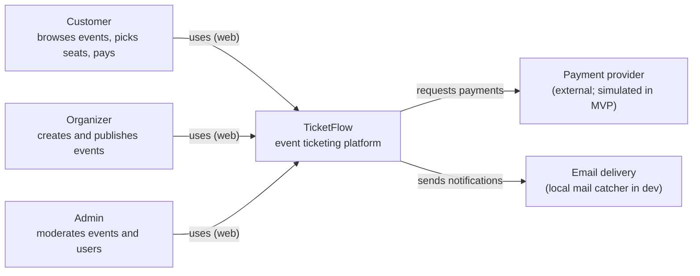
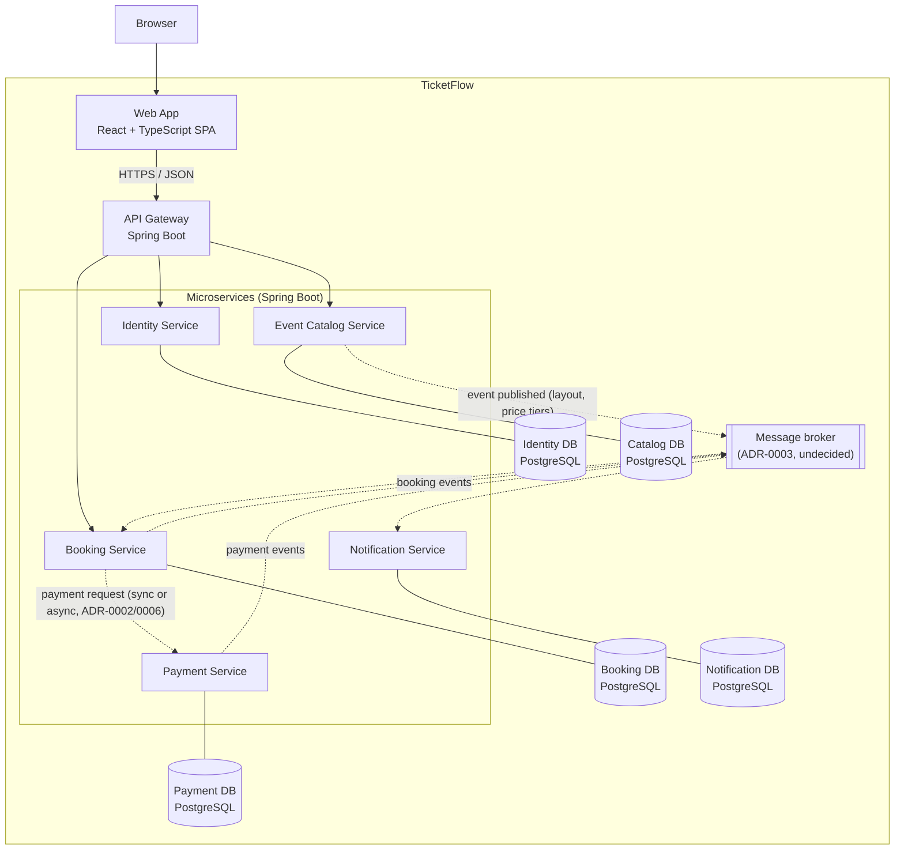
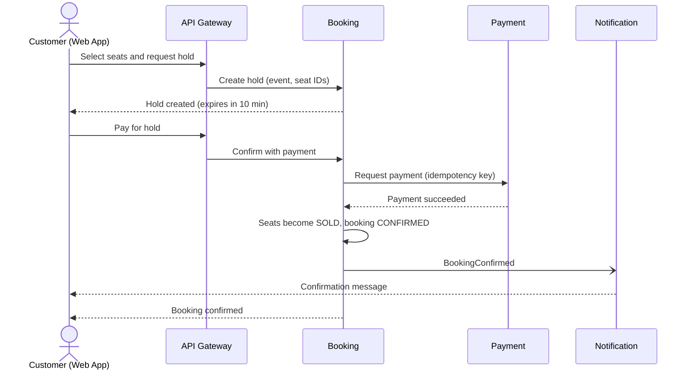

# System context and containers (C4 levels 1 and 2)

| | |
|---|---|
| **Status** | Draft baseline for Phase 1 review |
| **Date** | 2026-11-01 |
| **Governs** | Charter v1.0, section 8 |

Everything on the communication arrows in this document is a **hypothesis** until ADR-0002, ADR-0003, ADR-0006 and ADR-0012 are accepted. Component responsibilities and data ownership are firmer and are the main subject of review.

## Level 1: System context

Assumption to confirm: notifications go out by email. The channel is not fixed by the charter.

## Level 2: Containers

Solid lines are client-facing calls we are confident about. Dashed lines are service-to-service interactions whose style is still to be decided.

## Component responsibilities and data ownership

| Component | Responsible for | Owns (source of truth) | Does **not** own |
|---|---|---|---|
| Web App | Rendering, seat selection UX, hold countdown | Nothing persistent | Business rules |
| API Gateway | Routing, token validation, rate limiting | Nothing | Business logic |
| Identity | Registration, login, token issuing, roles | Users, credentials, roles | Anything about events or bookings |
| Event Catalog | Events, venues, seat **layout**, price tiers, publishing | Event and venue definitions | Whether a seat is currently taken |
| Booking | Seat **state** per event, holds, expiry, bookings, cancellation | Seat state, holds, bookings | Event details, payment outcomes |
| Payment | Payment attempts, idempotency, simulated provider | Payment records | Bookings, seats |
| Notification | Templates, sending, delivery log | Delivery log | Triggering rules (reacts to events) |

**Ground rules (from the charter and ADR-0001):**
1. One database per service; no other service reads or writes it (NFR-2).
2. Services learn about each other's data only through APIs or events, never through shared tables.
3. The Booking service is the single authority on whether a seat is available (NFR-1).

## Preliminary booking flow (happy path)

Not shown, and the reason ADR-0006 matters: payment failure, payment timeout, duplicate payment callback, hold expiring during payment, and cancellation after confirmation.

## Open design questions (each must close in an ADR before code)

| # | Question | Why it is hard | ADR |
|---|---|---|---|
| Q1 | How does Booking learn the seat layout that Catalog owns? | Specific seats mean Booking needs thousands of seat records per event, created at publish time | 0012 |
| Q2 | Where do holds live and how do they expire reliably? | Must never double-sell (NFR-1) and survive a service restart (NFR-3) | 0012 |
| Q3 | Is booking-to-payment synchronous or event-driven? | Determines failure handling and the saga style | 0002, 0006 |
| Q4 | Do we need a message broker in the MVP at all? | Adds infrastructure and RAM on a laptop; may be avoidable early | 0003 |
| Q5 | How does the UI get live seat updates? | Polling is simple; push is more responsive | 0011 |
| Q6 | Where is the token validated, and how is the user identity passed on? | Security boundary between gateway and services | 0004 |
