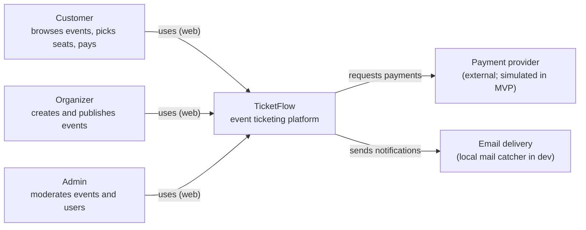
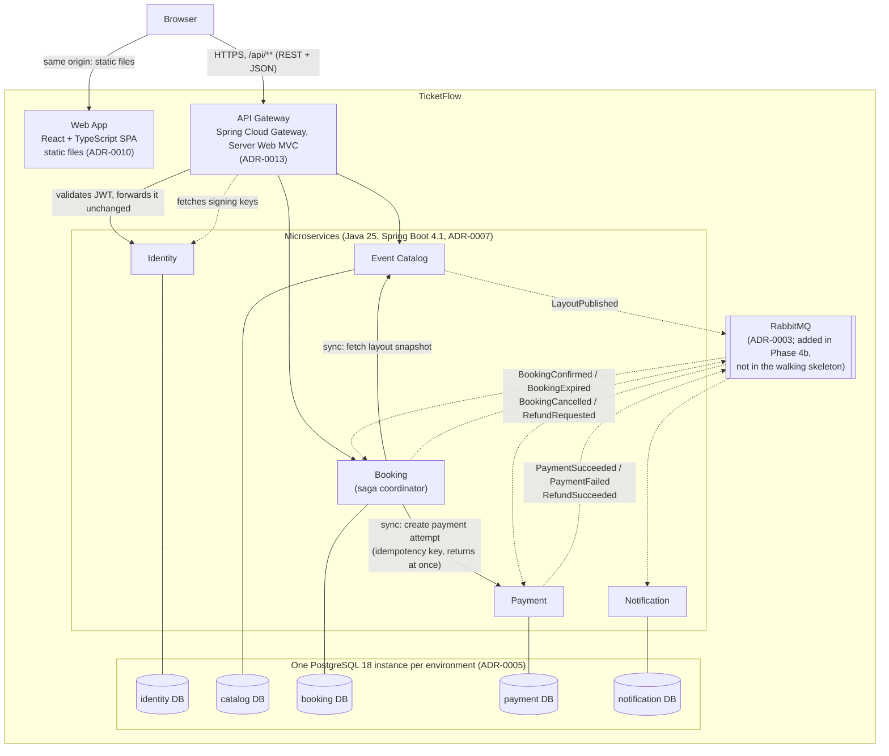
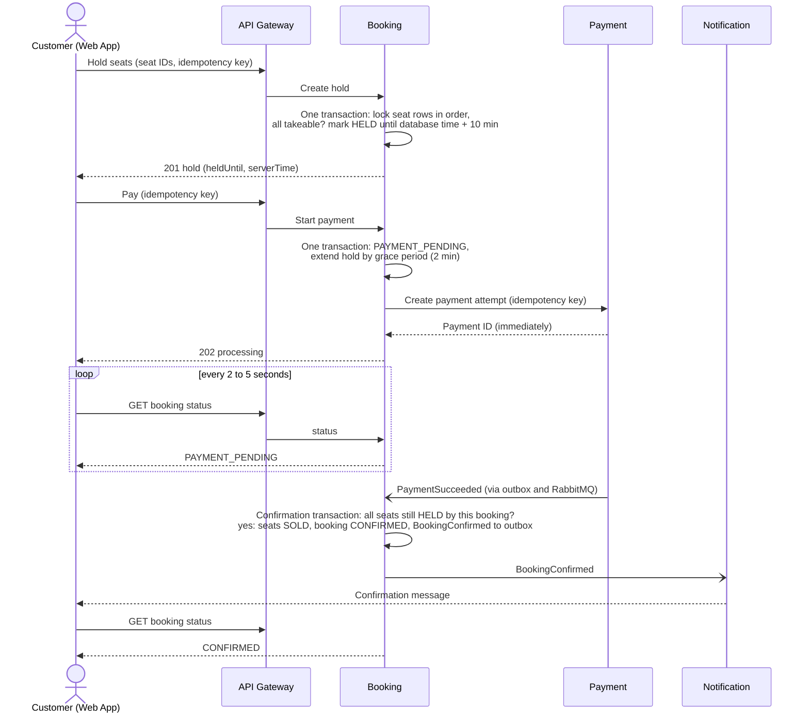

# System context and containers (C4 levels 1 and 2)

| | |
|---|---|
| **Status** | v2, Proposed (replaces the v1 baseline; becomes Accepted together with the ADRs) |
| **Date** | 2026-11-09 |
| **Governs** | Charter v1.1, section 8 |
| **Reflects** | ADR-0001 to ADR-0013 |

v1 of this document listed six open questions and treated every service-to-service arrow as a hypothesis. The ADRs now answer them (see the last section). This version shows the decided design. Where a decision is deferred on purpose (deployment target, backups, log retention), the text says so.

## Level 1: System context

Assumption still to confirm at the first Notification slice: notifications go out by email. The channel is not fixed by the charter.

## Level 2: Containers

Solid lines are synchronous requests. Dashed lines are events through the outbox and RabbitMQ (ADR-0002, ADR-0003) or key fetching. The complete list of allowed synchronous service-to-service calls is the two lines from Booking (ADR-0002, rule 5). Any new one requires an ADR update first.

**Cross-cutting (not drawn):** every request and event carries a correlation ID (ADR-0009). Services expose health endpoints, structured logs and metrics, and send traces through OpenTelemetry (ADR-0008); the `grafana/otel-lgtm` stack is opt-in and for development only. Services never trust the gateway: each validates the token itself (ADR-0004).

## Component responsibilities and data ownership

| Component | Responsible for | Owns (source of truth) | Does **not** own |
|---|---|---|---|
| Web App | Rendering, seat selection UX, hold countdown, polling for availability and payment status (ADR-0011) | Nothing persistent (access token in memory only) | Business rules |
| API Gateway | Routing, early token check, rate limiting, correlation ID, never routes `/internal/**` | Nothing | Business logic |
| Identity | Registration, login, token issuing, refresh rotation, roles, published signing keys | Users, credentials, roles, refresh-token hashes | Anything about events or bookings |
| Event Catalog | Events, venues, seat **layout**, price tiers, publishing, immutable layout snapshots | Event and venue definitions | Whether a seat is currently taken |
| Booking | Seat **state** per event, holds, lazy expiry and sweeper, bookings, the booking and payment saga, cancellation | Seat state, holds, bookings | Event details, payment outcomes |
| Payment | Payment attempts, idempotency, simulated provider, refunds | Payment records | Bookings, seats |
| Notification | Templates, sending, delivery log | Delivery log | Triggering rules (reacts to events only; exposes no endpoints to other services) |

**Ground rules (charter, ADR-0001 to ADR-0013):**
1. One database per service; no other service reads or writes it (NFR-2). Isolation is checked by an automated test (ADR-0005).
2. Services learn about each other's data only through APIs or events, never through shared tables or shared runtime libraries (ADR-0001, rule R2).
3. The Booking service is the single authority on whether a seat is available (NFR-1). A stale map in the browser can cause a refused hold, never a double sale (ADR-0011, ADR-0012).
4. Facts are events; requests are synchronous and idempotent (ADR-0002).

## Booking flow (happy path, as decided in ADR-0006 and ADR-0012)

The failure paths are decided in ADR-0006 and are not repeated here: payment failure (back to `HELD`, up to 3 attempts), provider timeout (unknown outcome, not failure), duplicate and late events (conditional updates and refunds), hold expiring during payment (grace period, then refund if payment arrives late), and cancellation after confirmation.

## How the earlier open questions were answered

| # | Question (v1) | Answer | ADR |
|---|---|---|---|
| Q1 | How does Booking learn the seat layout Catalog owns? | Catalog publishes an immutable layout snapshot and a `LayoutPublished` event. Booking fetches the snapshot and creates its seat rows idempotently | 0012, 0002 |
| Q2 | Where do holds live and how do they expire? | In Booking's PostgreSQL seat rows, with database-clock deadlines. Lazy expiry gives correctness, a sweeper gives tidiness | 0012 |
| Q3 | Is booking-to-payment synchronous or event-driven? | Both: a synchronous create call that returns at once, and the result as an event. Booking coordinates the saga | 0002, 0006 |
| Q4 | Do we need a message broker in the MVP? | Yes, RabbitMQ with the outbox, introduced in Phase 4b. The walking skeleton runs without it | 0003 |
| Q5 | How does the UI get live seat updates? | Polling (3 seconds, ETag and 304), behind a replaceable interface | 0011 |
| Q6 | Where is the token validated? | At the gateway early and again in every service. The original token is forwarded unchanged | 0004, 0013 |

## Still deliberately open

- **Deployment target, backups, log retention, TLS termination and the production edge component** are decided at the deployment gate before the walking skeleton is declared done (charter section 7, ADR-0005, ADR-0008, ADR-0013).
- **Email as the notification channel** is confirmed at the first Notification slice.